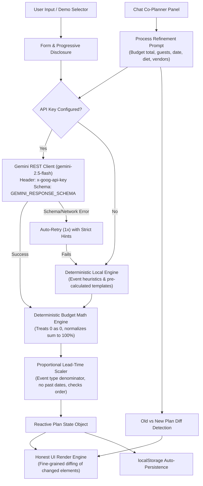

# Gatherly — GenAI Celebration & Event Planning Assistant

> A modern, zero-build, single-file GenAI planning assistant built for weddings, milestone birthdays, and community festivals. Combines conversational AI refinement via Gemini (`gemini-2.5-flash`), a deterministic budget engine, dated milestone timelines with proportional lead-time scaling and `.ics` export, vendor diligence checklists, and strict security validation.

---

## 1. What It Does

Gatherly transforms traditional, rigid event planning forms into an active **co-planning conversation**:

- **Co-Planner Assistant (Not Just a Form)**: Operates on a unified reactive JSON plan state. Users can chat with the assistant to adjust budgets (*"make it 15% cheaper"*), change guest counts (*"change to 60 guests"*), shift dates (*"move date to 2026-12-25"*), customize diets (*"add Jain menu"* vs *"add vegan menu"*), or add vendors (*"add a vendor: Live Saxophonist"*). Changes re-render with fine-grained DOM highlight animations on only the specific items that changed.
- **Structured Output Reliability**: Employs Gemini's `responseSchema` (JSON schema mode) with support for optional dynamic property updates (`newBudget`, `newGuests`, `newDate`), automated single-retry failover on schema/network failure, and zero silent merging of corrupt data.
- **Deterministic Budget Engine**: Eliminates LLM math hallucinations. The AI proposes category weight percentages, while a client-side JavaScript engine calculates precise rupee amounts, treats 0 as 0, drops invalid categories, balances rounding down to the exact rupee, computes cost-per-guest, and flags city-specific budget realism alerts. Users can log actual spend against estimates with an inline SVG donut breakdown. If category percentages differ from 100%, the engine normalizes them and displays an explicit explanatory note.
- **Real Calendar Timeline with Proportional Scaling**: Back-calculates milestone dates based on event-type lead times (180 days for weddings, 30 days for birthdays, 60 days for community events). When the available days are less than the ideal lead time, ALL milestones are scaled proportionally using the event type's full lead time as denominator. Milestones are never dated before today, phase order (`Plan` → `Book` → `Confirm` → `Event day`) is strictly maintained, and an alert banner details exactly which tasks were squeezed. Also generates downloadable standard `.ics` calendar files.
- **Vendor Diligence Checklists**: Provides actionable questions to ask, contract red flags to avoid, estimated budget brackets, status trackers (*To contact*, *Quoted*, *Booked*), and user note persistence powered by `localStorage`.
- **Personalized Ideas (7 Dimensions)**: Categorized creative suggestions for *Theme*, *Decor*, *Menu*, *Activities*, *Return Gifts*, *Music/Playlist*, and *Accessibility/Inclusion*. Includes a dedicated "Refresh Ideas" generator that preserves user-customized budget allocations, actual spend, and vendor notes.
- **Security & Strict Sanitization**: Every interpolated string is strictly escaped. Plans loaded from the URL hash (`#plan=`) or `localStorage` are rigorously validated against a strict schema (types, string length limits, allowed enums) and rejected on failure with a security alert toast.
- **Zero-Key Demo Mode**: Ships with 3 rich, realistic pre-generated plans (Jaipur Royal Wedding, Bengaluru 30th Rooftop Soirée, Pune Green Harvest Fair) so evaluators can test all features without needing an API key.

---

## 2. Interface Overview

```text
+--------------------------------------------------------------------------------------------------+
| GATHERLY  [AI Co-Planner]          Model: gemini-2.5-flash   [⚙ API Settings]  [★ Try Demo]      |
+--------------------------------------------------------------------------------------------------+
| HERO: "Make room for the moment."                                                                |
| Quick Demos: [Jaipur Wedding (₹15L)]  [30th Soirée (₹1.2L)]  [Eco Harvest (₹3.5L)]               |
+---------------------------------+-----------------------------------+----------------------------+
| 1. EVENT CONFIGURATION          | 2. INTERACTIVE PLAN CANVAS        | 3. CO-PLANNER CHAT         |
|                                 |                                   |                            |
| Celebrating: [Birthday       ▼] | [✦ AI-Generated]                  | Chat stream:               |
| Occasion:    Milestone 30th     | Aarav's 30th Terrace Soirée       | > User: "Make it cheaper"  |
| Guests: [45]  Budget: [₹1,20,000| 👥 45 Guests | 📍 Bengaluru        | > Co-Planner: "Trimmed     |
| Date: [2026-11-28] City: Blr    | ₹2,667/guest | 28 days left       |   budget 15% to ₹1,02,000" |
| Vibe: Cozy terrace, fairy lights|                                   |                            |
|                                 | [Realism & Squeezed Alerts]       | Quick prompt chips:        |
| [▶ Custom Preferences & Style]  |                                   | [Make it 15% cheaper]      |
| - Cultural: Urban Boho          | [DETERMINISTIC BUDGET]            | [Add Jain menu]            |
| - Dietary: Vegan & tapas        | Planned: ₹1,20,000 | Spent: ₹0    | [Add Vegan menu]           |
| - Priorities: Food, Decor, Music| SVG Donut Chart + Spend Tracker   | [60 guests]                |
|                                 | (Normalization note if != 100%)   | [Venue booked]             |
| [ Generate Plan ✦ ]             |                                   | [Add a vendor: DJ]         |
|                                 | [DATED TIMELINE & .ICS EXPORT]    |                            |
|                                 | Proportional scaling & order check| [ Tell co-planner... ] [▶] |
|                                 | Phases: [Plan] [Book] [Confirm]   |                            |
|                                 |                                   |                            |
|                                 | [VENDOR DILIGENCE & RED FLAGS]    |                            |
|                                 | Questions, red flags, notes       |                            |
|                                 |                                   |                            |
|                                 | [CURATED IDEAS (7 CATEGORIES)]    |                            |
|                                 | [Print] [Copy] [JSON] [Share Link]|                            |
+---------------------------------+-----------------------------------+----------------------------+
```

---

## 3. Architecture & Data Flow



---

## 4. Known Limitations

1. **Client-Side API Key Storage**: For no-build ease of use, API keys are stored in the browser's `localStorage` and sent directly to Google via the `x-goog-api-key` header. In production multi-tenant environments, API calls should route through a server-side authentication proxy to keep keys completely private.
2. **Offline Chat Intent Scope**: When operating without a Gemini API key, Gatherly relies on a rule-based offline intent engine that recognizes budget cuts, guest count adjustments, date shifts, separate Jain vs Vegan dietary updates, venue booking, and vendor additions. Complex open-domain conversational inquiries require an active Gemini API key.
3. **Calendar All-Day Boundaries**: The generated `.ics` calendar events use standard whole-day calendar boundaries (`VALUE=DATE:YYYYMMDD`). Time-of-day notification alarms can be customized inside Google Calendar or Apple iCal after import.
4. **Browser Rate Limits**: Requests are bound by Google AI Studio API rate limits for the configured model (`gemini-2.5-flash`). Quota errors (HTTP 429) are surfaced in the toast with the failing model name.

---

## 5. 60-Second Evaluator Demo Script

| Step | Action | What to Observe |
|:---:|:---|:---|
| **1** | Open `index.html` in any browser. | Notice clean typography, zero build requirement, and the header badge displaying `Model: gemini-2.5-flash`. |
| **2** | Open **⚙ API Settings** and click **"Test Connection"**. | If no key is entered, a toast prompts for a key with `[gemini-2.5-flash]`. Once entered, it verifies connectivity in real time. |
| **3** | Click the **"Jaipur Royal Wedding (₹15L)"** hero chip. | Instant population of a 250-guest celebration with a ₹6,000/guest metric and 6-month dated lead times. |
| **4** | Test **Offline Chat Intents**. | Type `"add strict Jain menu"` into chat. Observe that only the menu ideas and dietary badge update with a green flash (no vegan conflation). Then type `"change guests to 70"` and observe the cost-per-guest recalculate with honest element diffing. |
| **5** | Test **Venue Booking**. | Type `"venue is booked"`. Notice that the Haveli status changes to `Booked ✓` without auto-filling actual spend. |
| **6** | Test **Timeline Compression**. | Change the date to 10 days from today and click "Generate Plan ✦". Observe that milestones scale proportionally within 10 days, none are dated in the past, and an alert lists which tasks were squeezed. Click **"📅 Download .ics"** to export the calendar file. |
| **7** | Test **Security Rejection**. | Add a malformed `#plan={"title":"<script>","budget":"infinite"}` to the URL. Observe that Gatherly's strict schema validator rejects the data and keeps the app secure. |